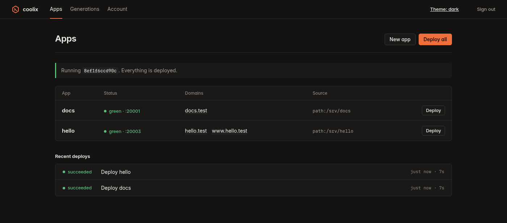
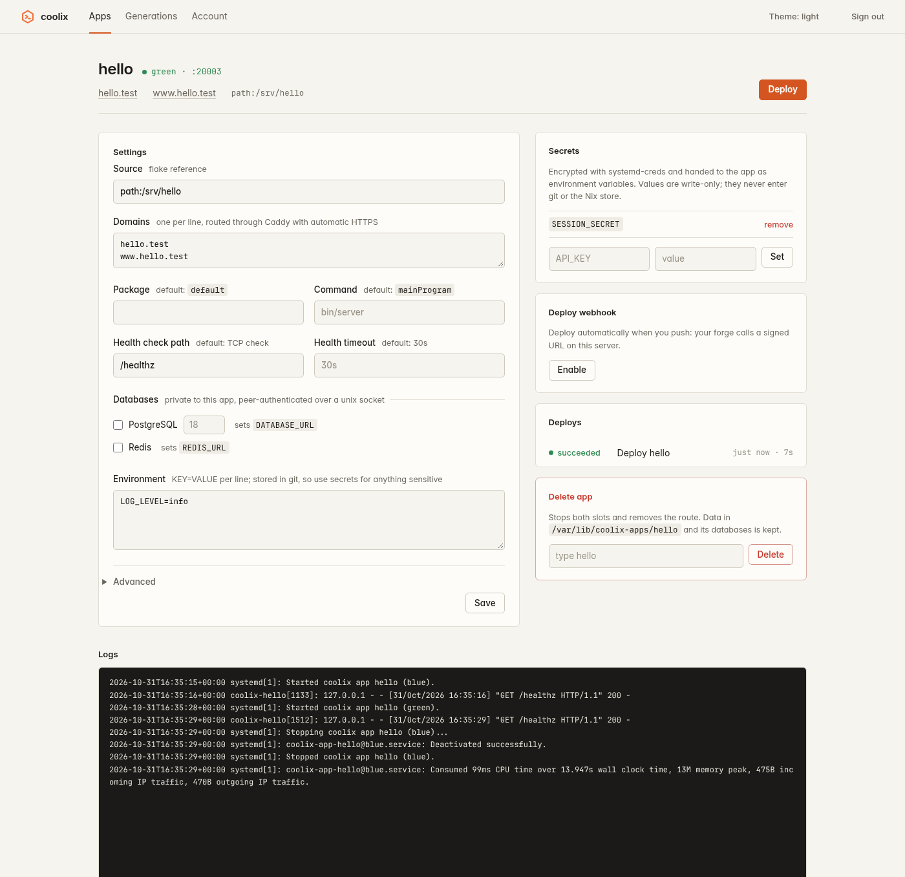
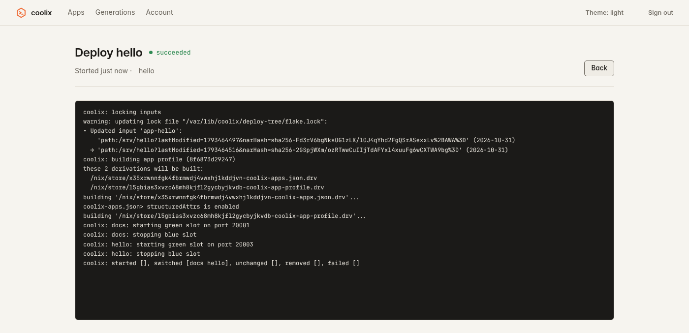
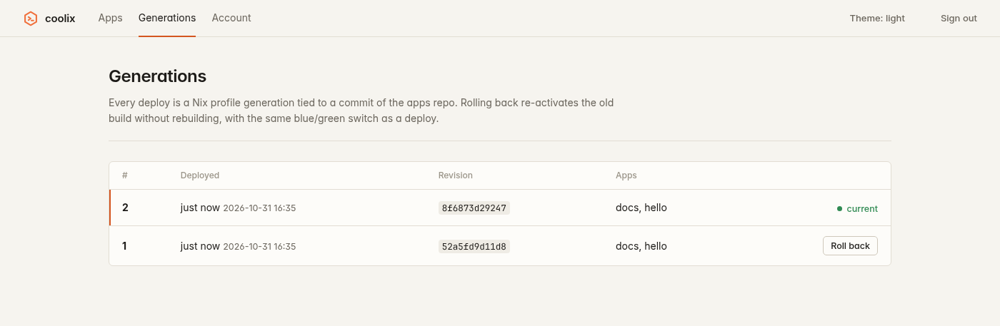
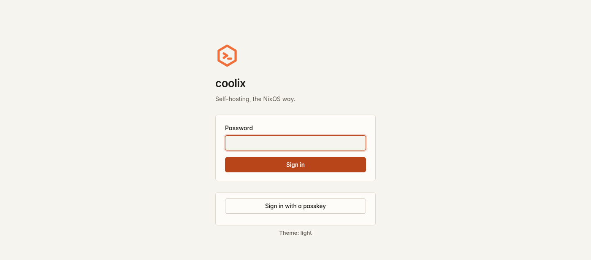
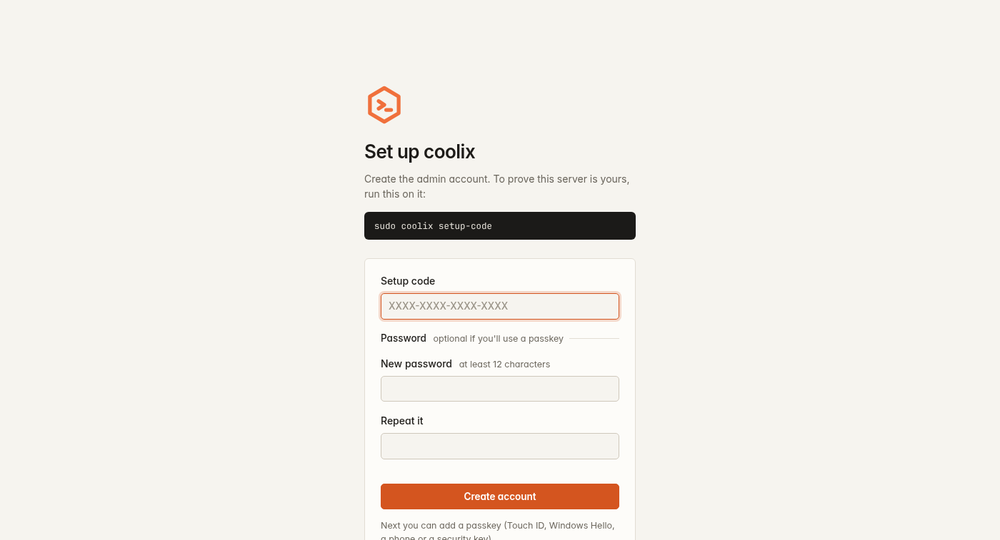
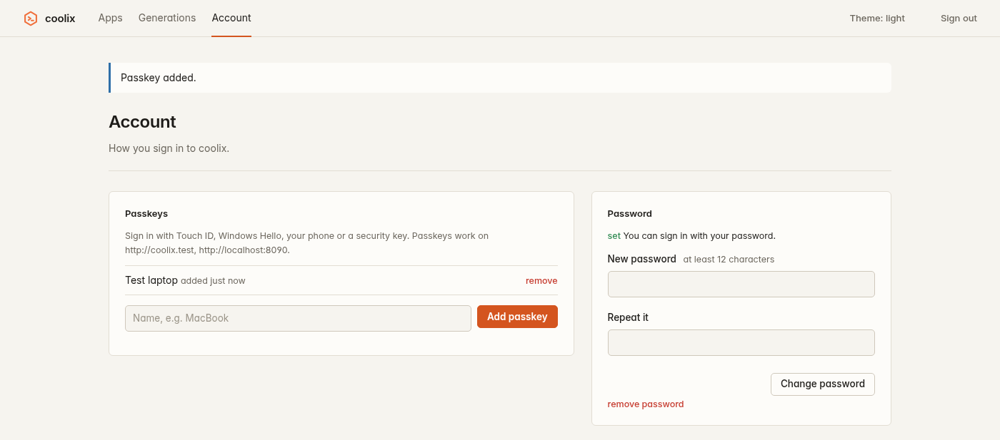
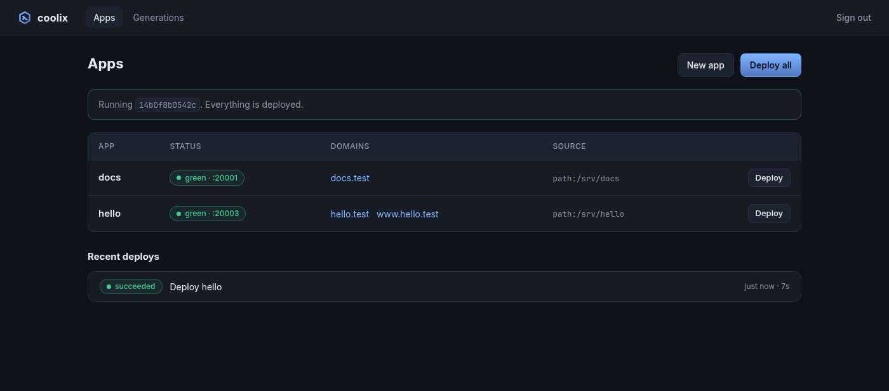
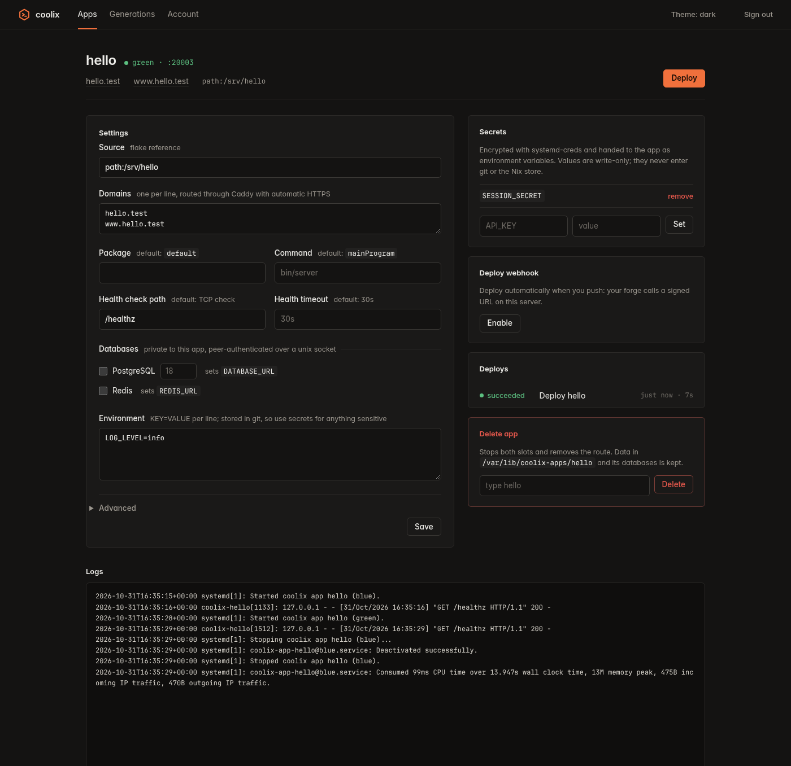

# coolix

[](https://github.com/Sejder/coolix/actions/workflows/ci.yml)

A self-hosting platform in the spirit of [Coolify](https://coolify.io) and
[Dokploy](https://dokploy.com), built natively for NixOS. There's no Docker:
apps are Nix flakes that run as hardened systemd units, and everything that's
deployed is recorded in a git repo.



> **Status:** young. All milestones of the first version are done and covered
> by NixOS VM tests, but nobody has run it in production yet. Expect rough edges.

## Features

- **Flakes in, URLs out.** Point coolix at any flake exposing
  `packages.<system>.default` that listens on `$PORT`, and add a domain.
  Caddy routes it with automatic HTTPS.
- **Zero-downtime deploys.** Every app has a blue and a green slot. A deploy
  starts the idle slot, waits for its health check, moves traffic, then stops
  the old one. If the new version is unhealthy, the old one keeps serving.
- **Git is the source of truth.** App definitions are `app.toml` files in a git
  repo that coolix commits to on every change. The UI and CLI just edit it.
- **Rollback in a second.** Each deploy is a Nix profile generation. Rolling
  back re-activates an old build without rebuilding, and commits the matching
  repo state.
- **Databases included.** Tick a box for a private PostgreSQL or Redis per
  app. It's reachable only by that app over a unix socket with peer
  authentication, so there are no passwords to manage, and `DATABASE_URL` and
  `REDIS_URL` are set for you.
- **Real secrets.** Secret values are encrypted with `systemd-creds` (TPM2
  and/or host key) and handed to the app through `LoadCredentialEncrypted=`.
  They never enter git, the Nix store or a world-readable file.
- **Hardened by default, and it stays that way.** Apps run with `DynamicUser`,
  `ProtectSystem=strict`, a syscall filter and an empty capability set. Root
  renders every unit from validated data, so neither an app definition nor a
  compromised web UI can opt out of the sandbox.
- **Passkeys.** Sign in with Touch ID, Windows Hello, a phone or a security key,
  a password, or both. A fresh install can only be claimed with a code from
  the server itself.
- **Deploy on push.** `git push coolix@host:app main` builds and deploys,
  Heroku-style. Or keep the code on your forge, and give it a signed webhook
  URL (GitHub, Gitea, Forgejo, GitLab or any CI job).
- **Database backups.** Scheduled or on-demand `pg_dump`s with retention, and
  restores from the UI or CLI.
- **Resource limits, migrations, runtime packages.** Memory, CPU and task
  limits per app, a `pre_start` command, and nixpkgs tools on `PATH`.
- **NixOS-native.** One module, no containers, and your host's
  `nixos-rebuild` is never involved in deploying an app.

| App | Live deploy log |
|---|---|
|  |  |
| **Generations** | **Sign in (passkey or password)** |
|  |  |
| **First-run setup** | **Account and passkeys** |
|  |  |
| **Light theme** | **Dark theme** |
|  |  |

The screenshots are taken by a NixOS VM test that drives the real UI in
headless Chromium (`tests/ui.nix`), so they always show the current version.

## Quick start

Add coolix to your NixOS flake:

```nix
{
  inputs.coolix.url = "github:Sejder/coolix";

  outputs = { nixpkgs, coolix, ... }: {
    nixosConfigurations.myhost = nixpkgs.lib.nixosSystem {
      modules = [
        coolix.nixosModules.default
        {
          services.coolix = {
            enable = true;
            caddy.acmeEmail = "you@example.com";
            caddy.openFirewall = true;
            ui.domain = "coolix.example.com";
          };
        }
      ];
    };
  };
}
```

Open `https://coolix.example.com`. To prove the server is yours, the setup page
asks for a one-time code: run `sudo coolix setup-code` on the server. Then add a
passkey and/or a password. (Prefer it declarative? Set
`ui.adminPasswordFile`, e.g. from agenix or sops-nix.)

Then deploy your first app, either from the web UI or the CLI:

```sh
# Start from a template (go, node, python or rust)
nix flake init -t github:Sejder/coolix#go

# Point coolix at it
sudo coolix app add blog --source github:you/blog --domain blog.example.com --health-path /healthz
sudo coolix deploy blog
```

## CLI

```text
coolix app add NAME --source REF [flags]   add an app
coolix app set NAME [flags]                change it: --source, --domain, --env K=V, --unset-env K,
                                           --health-path, --health-timeout, --package, --command,
                                           --pre-start, --pre-start-timeout, --path ATTR, --memory-max, --cpu-quota,
                                           --tasks-max, --db postgres[:VERSION] / --db redis / --db none,
                                           --backup-schedule, --backup-keep, --branch
coolix app rm NAME                         remove it (applied on next deploy)
coolix app list
coolix secret set APP KEY < value          set a secret (applied on next deploy)
coolix secret unset APP KEY
coolix secret list APP
coolix deploy [NAME]                       build and activate; with NAME, also update that app's source
coolix status                              running slots, and whether the repo has undeployed changes
coolix logs APP [-f] [-n LINES]            the app's logs, including its databases and backups
coolix generations
coolix rollback [GEN]
coolix db backup APP                       dump the app's postgres database now
coolix db backups APP                      list its dumps
coolix db restore APP BACKUP               replace the database's contents with a dump
coolix webhook enable|show|disable APP     manage the app's deploy webhook
coolix ssh-key add [NAME] < key.pub        allow a key to git push (also: ssh-key list, ssh-key rm NAME)
coolix setup-code                          one-time code to create the UI's admin account
coolix account reset                       remove the admin's password and passkeys (lost access)
```

Run it with `sudo`. It drops to the unprivileged `coolix` user straight away.

## Writing an app

An app is any flake with `packages.<system>.default` whose main program:

- listens on `127.0.0.1:$PORT` (coolix gives each slot its own port),
- answers a health check: a TCP connect by default, or `GET <health path>` < 400,
- keeps state in its working directory (`/var/lib/coolix-apps/<name>`, shared
  by both slots) or in its database.

It also receives `COOLIX_APP`, `COOLIX_SLOT`, your environment variables and
secrets, and `DATABASE_URL`/`PGHOST`/`PGUSER`/`PGDATABASE` and `REDIS_URL` when
it has those databases. The [templates](templates/) are minimal starting points
for Go, Node, Python and Rust.

Since the app runs under systemd's `DynamicUser`, its `PATH` is minimal.
Reference the tools you need through Nix (`${pkgs.foo}/bin/foo`), or list
them in `path` in `app.toml`.

## Documentation

- [How it works](docs/architecture.md): the apps repo, profiles, activation, blue/green and the security model
- [`app.toml` reference](docs/app-toml.md)
- [NixOS options](docs/options.md), including the admin account and upgrade notes

## Development

```sh
nix develop -c go test ./...                  # unit tests
nix flake check -L                            # everything, incl. NixOS VM tests (needs KVM)
nix build .#checks.x86_64-linux.vm-ui -L      # UI test; screenshots in result/screenshots/
```

CI runs the same commands on GitHub Actions, with KVM for the VM tests.

## Not yet

PR preview environments, off-host backups, multiple users, and multi-host
deployments.
